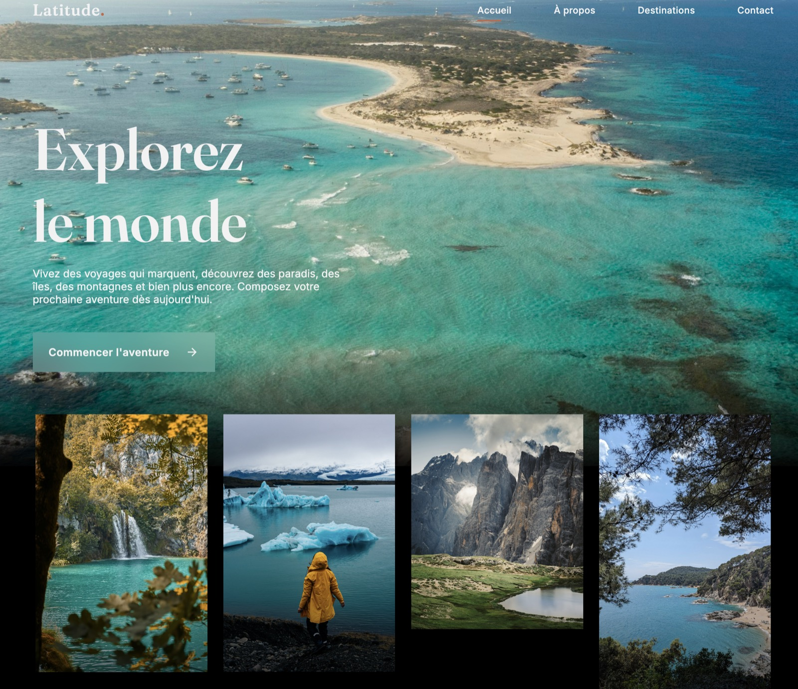

# Latitude

Latitude est une agence de voyage en ligne. Le site présente une sélection
de destinations à travers le monde, de la plage à la montagne, avec pour
chacune une fiche détaillée (description, durée conseillée, saison,
budget indicatif) et un catalogue filtrable par ambiance.

## Pages

- `index.html` : Accueil, avec présentation, destinations phares,
  témoignages et inscription à la newsletter.
- `destinations.html` : Catalogue complet des destinations, avec filtres
  par ambiance (plage, montagne, nature, île) et recherche par nom ou
  pays.
- `destination.html?id=...` : Fiche détaillée d'une destination
  (description, durée, budget, saison, destinations similaires).
- `contact.html` : Formulaire de contact et coordonnées de l'agence.
- `mentions-legales.html` : Mentions légales du site.

## Stack

HTML / CSS / JavaScript, [RemixIcon](https://remixicon.com/) et
[ScrollReveal](https://scrollrevealjs.org/) pour les animations.

## Lancer le projet

Aucune dépendance : ouvrir `index.html` dans un navigateur, ou servir le
dossier avec un serveur statique (ex. `npx serve`).
